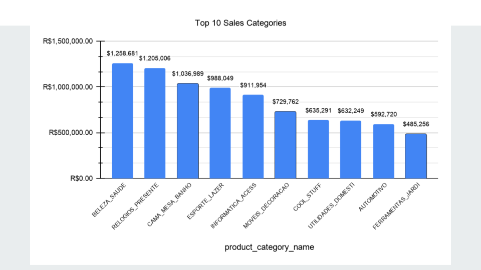
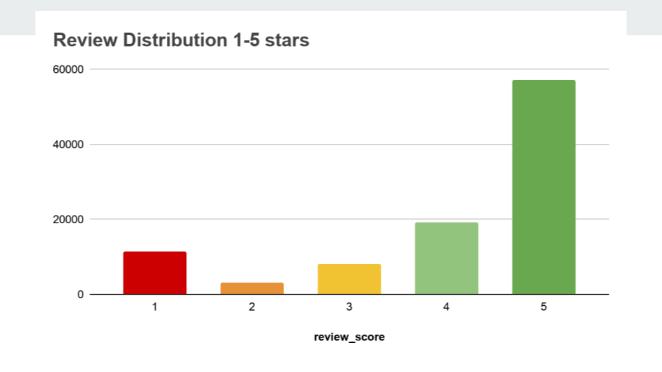
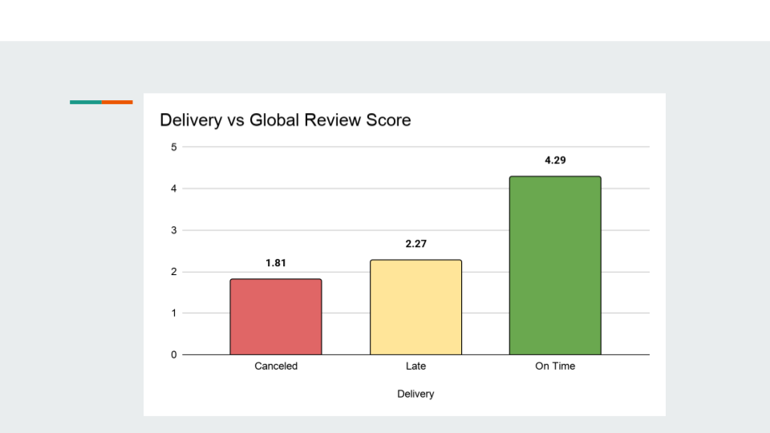

# Olist E-commerce: Product Performance & Customer Satisfaction

## Project Overview

This project explores Olist's Brazilian e-commerce data, focusing on product performance, sales revenue and customer satisfaction.

The analysis investigates differences in product category performance and explores how delivery reliability relates to customer reviews.

## Research Questions

- Which product categories generate the highest and lowest sales revenue?
- How do customer ratings vary across product categories?
- How does delivery performance relate to customer satisfaction?
- What business opportunities can be identified from these findings?

## Key Findings

- **Product performance:** The analysis identifies the highest- and lowest-revenue product categories.
- **Customer satisfaction:** Customer review scores vary across product categories.
- **Delivery performance:** Orders delivered on time received an average review score of 4.29, compared with 2.27 for late deliveries.
- **Business opportunity:** Delivery reliability is an important area for improving the customer experience.

## Business Recommendations

- Investigate the causes of late deliveries and opportunities to improve logistics.
- Monitor customer satisfaction alongside delivery and sales performance.
- Review underperforming product categories to identify opportunities for improvement.
- Use customer feedback to inform business decisions.

## Project Presentation

The full analysis and visual findings are available in the presentation included in this repository.

## Project Status

This repository currently contains the project presentation. Supporting code and technical documentation may be added as they become available.

## Project Visualisations

### Top Product Categories

### Customer Review Distribution

### Delivery Performance and Customer Reviews

